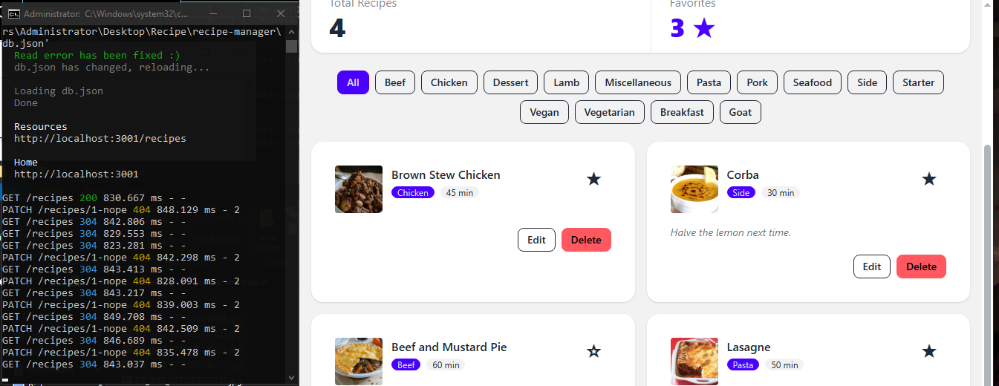

# Recipe Manager — Data-Driven Recipe App

A data-driven recipe management application built with **React, TypeScript, Vite, TanStack Query, Axios, Tailwind CSS, DaisyUI, and json-server**.

The application lets users search for meals from TheMealDB, save recipes locally through a REST API, organize saved recipes by category, manage recipe details, and mark favorites.

## Features

- **Meal Search:** Search for meals using TheMealDB's public API.
- **Category List:** Retrieve available meal categories.
- **Save Recipes:** Save meals to the local recipe database.
- **Saved Recipes:** Display and manage saved recipes.
- **Category Filtering:** Filter saved recipes by category.
- **Edit Recipes:** Update preparation time and personal notes.
- **Delete Recipes:** Remove saved recipes.
- **Favorite Recipes:** Mark and unmark recipes as favorites.
- **Optimistic Updates:** Update favorite status immediately while the server request is processing, with rollback if the request fails.
- **Loading and Error States:** Display appropriate feedback during data requests.

## Technologies Used

- React 19
- TypeScript
- Vite
- TanStack Query
- Axios
- Tailwind CSS
- DaisyUI
- json-server 0.17.4
- TheMealDB API

## Requirements

Before running the project, install:

- Node.js and npm
- Git

## Getting Started

### 1. Clone the repository

```bash
git clone https://github.com/belarminoharie-Beatl3ss/recipe-manager.git
cd recipe-manager
```

### 2. Install dependencies

```bash
npm install
```

### 3. Configure environment variables

Copy the example environment file.

**Windows CMD:**

```cmd
copy .env.example .env
```

The `.env` file should contain:

```env
VITE_MEALDB_URL=https://www.themealdb.com/api/json/v1/1
VITE_API_URL=http://localhost:3001
```

The `.env` file is excluded from Git. The committed `.env.example` provides the required configuration for other users.

### 4. Start the local API server

Open a terminal in the project directory and run:

```bash
npm run api
```

The json-server API will run at:

```text
http://localhost:3001
```

The API uses `db.json` as its database and has an 800 ms response delay.

### 5. Start the development server

Open a second terminal in the same project directory and run:

```bash
npm run dev
```

Open the local address shown by Vite, usually:

```text
http://localhost:5173
```

Keep both terminals running while using the application.

## Production Build

To check TypeScript and generate the production build, run:

```bash
npm run build
```

The generated production files are placed in the `dist` directory.

## Project Structure

```text
recipe-manager/
|-- db.json
|-- .env.example
|-- .gitignore
|-- package.json
|-- vite.config.ts
|-- docs/
|   |-- optimistic-rollback.png
|-- src/
|   |-- components/
|   |   |-- CategoryFilter.tsx
|   |   |-- EditRecipeForm.tsx
|   |   |-- MealCard.tsx
|   |   |-- RecipeList.tsx
|   |   |-- SearchBar.tsx
|   |   |-- SummaryBar.tsx
|   |-- features/
|   |   |-- meals/
|   |   |   |-- meals.api.ts
|   |   |   |-- meals.hooks.ts
|   |   |   |-- meals.types.ts
|   |   |-- recipes/
|   |       |-- recipes.api.ts
|   |       |-- recipes.hooks.ts
|   |       |-- recipes.types.ts
|   |-- lib/
|   |   |-- api.ts
|   |-- App.tsx
|   |-- index.css
|-- README.md
```

## TanStack Query Keys

The application uses query keys to identify and manage cached server data.

### Meal search

```ts
queryKey: ["meals", term]
```

The search term is included in the query key. This keeps the cached results for different searches separate.

For example:

```ts
["meals", "chicken"]
["meals", "pasta"]
```

### Saved recipes

```ts
queryKey: ["recipes"]
```

This identifies the saved recipes returned by the local json-server API. Mutations invalidate this query when the saved recipe data needs to be refreshed.

### Categories

```ts
queryKey: ["categories"]
```

This identifies the categories retrieved from TheMealDB.

## Optimistic Favorite Update and Rollback Test

Favorite updates use an optimistic update strategy.

1. Cancel ongoing queries for the saved recipes.
2. Store a snapshot of the previous cached recipes.
3. Update the selected recipe's favorite status immediately.
4. If the server request fails, restore the previous cached data.
5. Invalidate the saved recipes query after the request settles.

### Rollback Test Screenshot

The screenshot below shows the optimistic favorite update during the failed-request test. The application restores the original favorite state when the request fails.



## Sample Data

The project includes four sample saved recipes in `db.json`:

- Brown Stew Chicken
- Corba
- Beef and Mustard Pie
- Lasagne

The local API stores recipe data in `db.json`.

## Submission

- Repository: [recipe-manager](https://github.com/belarminoharie-Beatl3ss/recipe-manager)
- Branch: `main`
- Required collaborator: `jeffdteach`
- Repository visibility: Public
